# Dayflow

Flutter 原生 Android 应用，手表执行任务、专注计时，手机编辑安排。直接连接 MySQL，Hermes 使用配套 skill 管理同一份任务数据，无后端 API。

每轮迭代的改进、修复和验证见 [更新记录](CHANGELOG.md)；公开版本与源码附件见 [GitHub Releases](https://github.com/xiaoj655/dayflow/releases)。

- 首页默认今日任务，左滑下一天、右滑前一天，可连续快速查看明天、后天；日期入口保留日历选择。手表使用按周排列的日历，附近日期点选即打开，支持滑动和表冠浏览，手机使用日历选择。完成任务沉底；恢复待办回到原排列顺序。
- 其他日期未完成的任务可手动“加入今天”，保留原日期记录与重复规则；今天已有同一任务时去重，不重置完成状态。Hermes skill 的 `carry --id` 支持同样操作。
- 任务字段：标题、内容、可选技巧/教程，以及任务价值、最低目标、完成标准、启动动作、预估分钟数。支持单次、每天、指定星期重复；新增信息可留空，预估时长不覆盖番茄钟的记忆时长。
- 手表采用 Wear OS 圆屏设计与 Material 控件，完整圆屏布局、普通纵向滚动、表冠滚动（2.04 倍，带轻微触感）；触摸操作优先，左边缘跟手右滑返回；列表边缘轻微缩小淡出，顶部弧形时间随滚动隐藏。
- 界面以黑白灰为主，主要操作按钮使用红色，选中项与运行中的专注圆环、状态少量用红色强调，分析时间轴局部用颜色区分记录。
- 专注时长 5–180 分钟、每格 5 分钟，表冠与鼠标滚轮切换带平滑动画；记忆上次实际启动的时长。暂停、继续、提前结束；结束短震两次，不自动休息或完成任务。
- 任务详情首尾各有随内容滚动的专注按钮，专注设置与结束页保留贴底主按钮，任务内容按需展开；从任务进入专注设置时隐藏任务选择器；通用专注入口保留选择功能。开始前和专注中显示任务名称，有启动动作时同步显示。
- 专注自动开启 App 自有勿扰规则，并通过小米系统联动手机；暂停、结束或提前停止后撤销本轮开启的勿扰，休息不启用。开始前已有勿扰时不接管；专注中观察到手动接管后不再撤销。首次开始前需授予通知、闹钟、勿扰控制和小米联动所需权限。
- 定时任务主动提醒、稍后再做及今天跳过暂不实现。
- 结束后可选择休息（当前默认 5 分钟）、继续专注或返回任务；也可直接从其他任务或自由专注入口开始新一轮，无需先关闭完成页。
- Android 使用持久化计时状态和系统精确闹钟，独立于 Flutter 页面；支持熄屏、后台及重启后恢复。需允许系统闹钟/提醒和通知权限，遵循系统勿扰设置。
- 本地缓存任务和待同步的完成状态、专注记录；联网后重放，专注记录按会话 ID 去重。

<!-- BEGIN WATCH SCREENSHOTS -->
## 手表界面

以下图片由实际 Flutter 页面自动渲染，使用固定演示任务、时间和字体；尺寸为 480×480、density 320，非实机截图。

<table>
  <tr>
    <td align="center">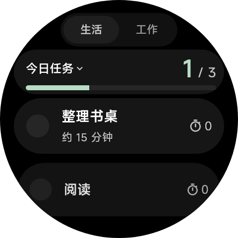<br>生活任务</td>
    <td align="center">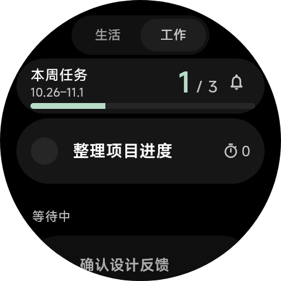<br>工作任务</td>
    <td align="center">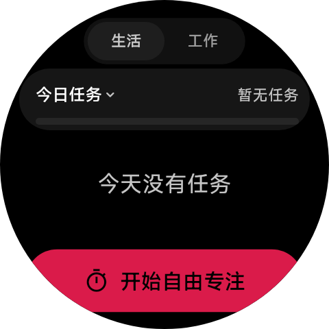<br>空任务</td>
  </tr>
  <tr>
    <td align="center">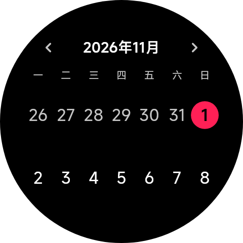<br>日期日历</td>
    <td align="center">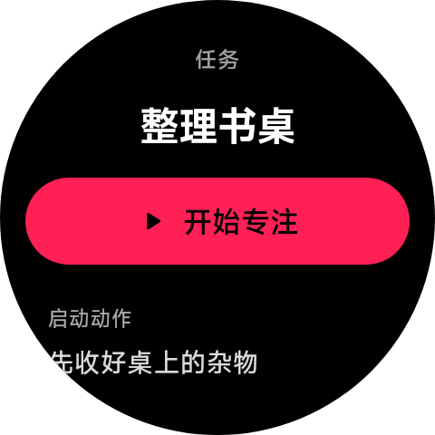<br>任务详情</td>
    <td align="center">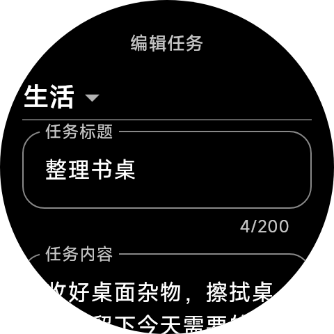<br>任务编辑</td>
  </tr>
  <tr>
    <td align="center">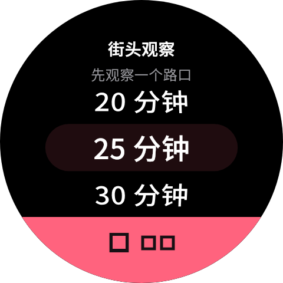<br>关联任务专注</td>
    <td align="center">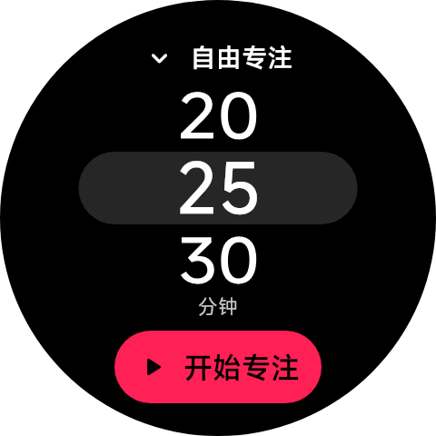<br>自由专注设置</td>
    <td align="center">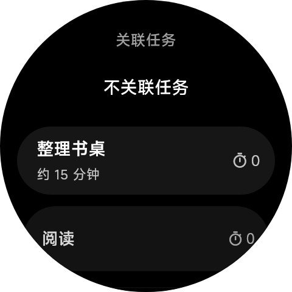<br>选择关联任务</td>
  </tr>
  <tr>
    <td align="center">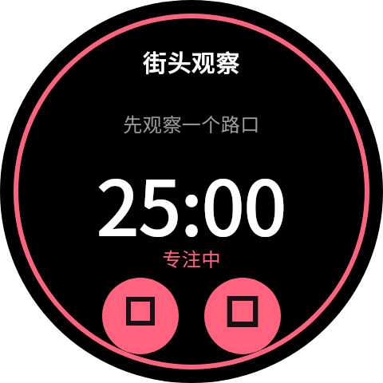<br>专注计时</td>
    <td align="center">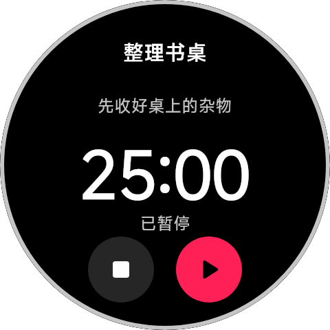<br>专注暂停</td>
    <td align="center">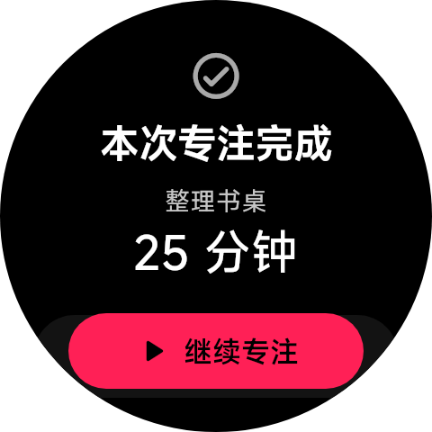<br>专注结束</td>
  </tr>
  <tr>
    <td align="center">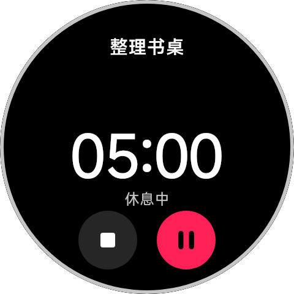<br>休息计时</td>
    <td align="center">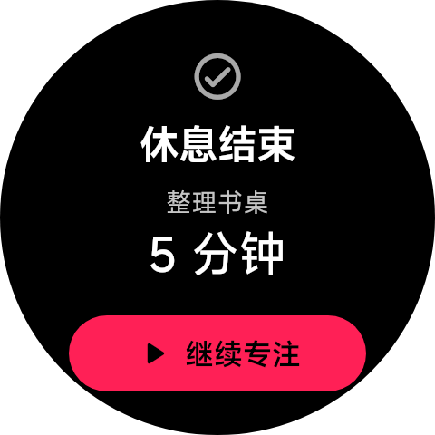<br>休息结束</td>
    <td align="center">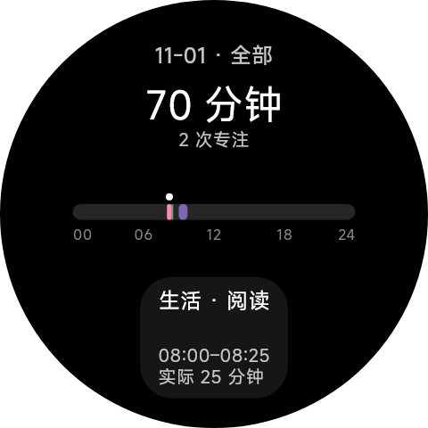<br>专注分析</td>
  </tr>
  <tr>
    <td align="center">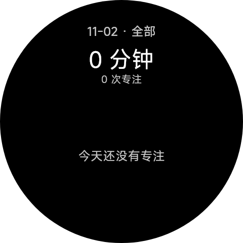<br>空分析</td>
    <td align="center"><br>工作提醒已关闭</td>
    <td align="center">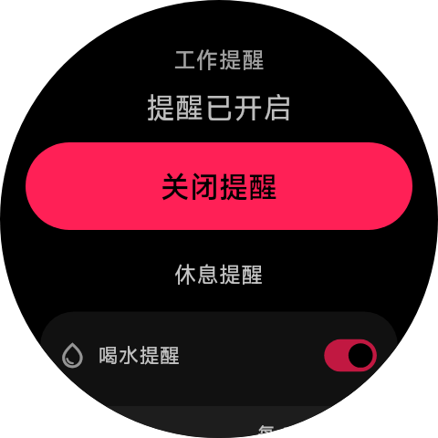<br>工作提醒已开启</td>
  </tr>
  <tr>
    <td align="center">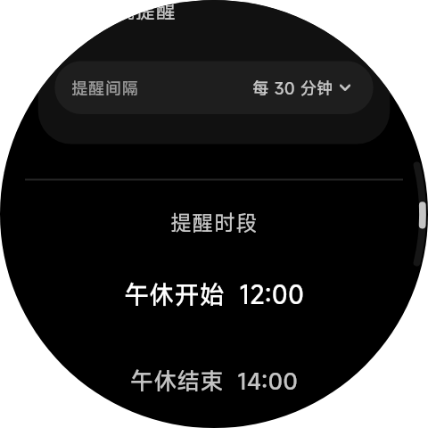<br>休息提醒设置</td>
    <td align="center">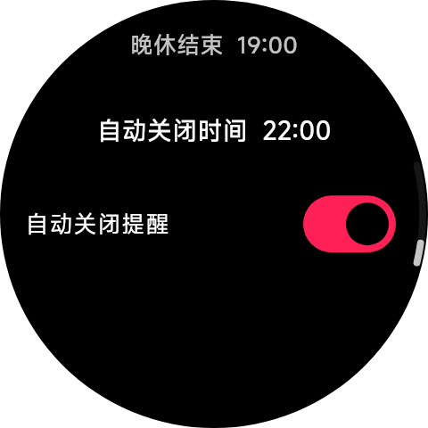<br>提醒时段设置</td>
    <td align="center">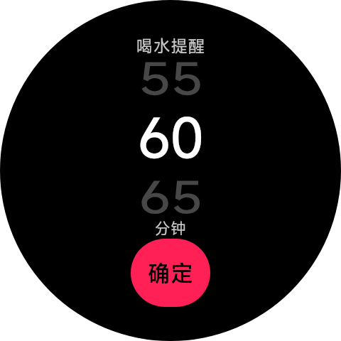<br>提醒间隔</td>
  </tr>
  <tr>
    <td align="center">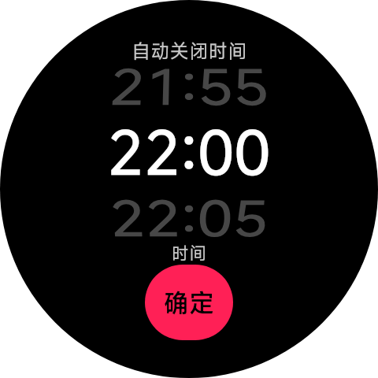<br>自动关闭时间</td>
    <td align="center">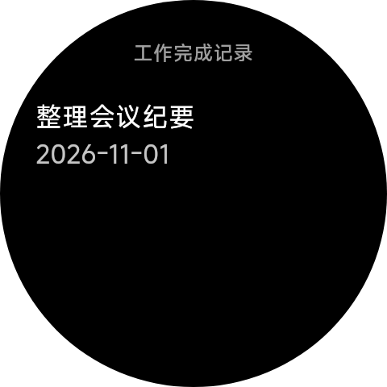<br>工作完成记录</td>
  </tr>
</table>

更新全部图片与此区块：

```bash
python3 scripts/capture_watch_ui.py
```

<!-- END WATCH SCREENSHOTS -->

## 部署与兼容性

对外名称为 Dayflow。内部 Flutter 包名 `life_assistant`、Android 包名 `com.example.life_assistant` 保留，已有安装和数据库无需因改名迁移。Hermes skill 使用 `skills/dayflow/`，命令为 `/dayflow`。

本项目以源码形式发布，使用者自建 MySQL、配置后自行编译；Hermes skill 可选。主要实测设备为小米手表 5（480×480、density 320）。其他圆屏、矩形 Android 设备可尝试使用，但表冠、触感和后台行为尚未全面验证。小米手机勿扰联动依赖厂商系统；不支持 Web 或多用户数据隔离。

完整步骤见 **[从零部署](docs/setup.md)**，包括数据库与权限、TLS 指纹、手表授权、Hermes 安装和数据库升级。

```bash
# Python 3.10+；只创建缺失文件，不覆盖已有配置。
python3 scripts/configure.py init
# 编辑 config/database.json，填写自己的数据库与证书指纹。
python3 scripts/configure.py check
flutter pub get --enforce-lockfile
flutter analyze
flutter test --exclude-tags=database
flutter build apk --release --target-platform android-arm,android-arm64
```

常用操作已收进 `Makefile`，`make help` 查看全部目标。`make check` 运行离线回归，`make build` 构建双架构 release APK，`make deploy DEVICE=<设备地址>` 构建并安装，`make screenshots` 更新手表截图；已安装 `dayflow-build.slice` 时构建自动套用内存限制。

`make install` 安装已构建的 APK：单台在线设备自动选择，同一设备的多个无线连接入口按设备序列号识别；有不同设备或无法核实时，使用 `make install DEVICE="<设备序列号>"` 指定。带空格、括号的无线调试名称同样支持。`make deploy` 和 `make grant` 使用相同的设备选择规则。

验证环境为 Flutter 3.47.8 / Dart 3.13.7、JDK 21。首次使用需要先创建数据库和导入表结构；应用不会自动建表或插入示例任务。

**配置在本地明文保存，也会被打进 APK。不要公开分发自己的 APK、连接配置或个人任务数据。** 真实配置和证书已加入 Git 忽略规则，公开模板为 `config/database.example.json` 与 `skills/dayflow/connection.example.json`。保留 TLS 指纹校验；详见 [SECURITY.md](SECURITY.md)。

当前 release 构建仍采用本机 debug 密钥签名，供个人自行编译使用；正式签名及安装后配置界面不在本次源码首版范围。

## 开发与验证

共用 Linux 服务器可安装 `scripts/dayflow-build.slice` 到 `/etc/systemd/system/`，执行 `systemctl daemon-reload` 后使用 `bash scripts/run_build.sh flutter build apk --release --target-platform android-arm,android-arm64`。构建及子进程共享 4 GiB 内存、512 MiB swap 上限，3.5 GiB 起回收；直接执行 Gradle（含 Flutter 调用）也会自动进入该分组。配置了 systemd-oomd 时，持续内存压力会提前终止构建分组。此限制不覆盖其他后台服务。

Gradle 堆上限为 2 GiB，Kotlin 为 1 GiB，最多两个 worker，空闲五分钟退出。额度不足时先检查构建峰值，不直接扩大到整机内存。

```bash
python3 -m unittest discover -s test -p '*test*.py'
flutter analyze
flutter test --exclude-tags=database
# 在 android/ 下执行原生计时与勿扰测试：
cd android
./gradlew :app:testDebugUnitTest
```

常规检查不访问数据库；集成测试需要显式启用并连接独立测试库，见 [部署说明](docs/setup.md)。GitHub Actions 使用示例配置运行离线测试与双架构 release 构建，不上传 APK。

图标源文件为 `dayflow-icon.png`，替换后执行 `dart run flutter_launcher_icons`。通知小图标使用原图白色标记的透明单色版本（`ic_notification.png`），通知大图标沿用应用图标。数据结构源为 `database/schema.sql`，同步维护 skill 的 `references/schema.sql`，升级使用增量迁移。

参与开发见 [CONTRIBUTING.md](CONTRIBUTING.md)，设备适配和产品约定见 [AGENTS.md](AGENTS.md)。

手表截图的生成方法见 [截图自动化说明](docs/screenshots.md)。CI 会生成 `watch-ui-docs` 图片与文档产物。

## 导出公开源码

```bash
python3 scripts/export_source.py --check
python3 scripts/export_source.py
```

生成 `build/dayflow-source.zip`，只包含选定源码目录、文档及构建输入，排除真实配置、PEM、密钥、虚拟环境、缓存和安装包；发现已知本地连接信息被复制进源码或发现私钥标记时拒绝导出。该检查不代替完整敏感信息审查，也不清理 Git 历史。

此工作目录可能保留个人配置及旧构建产物，请使用导出的源码包建立公开仓库，不要把整个工作目录压缩上传。首次发布还需检查实际待提交文件；若其他仓库历史或附件泄露过凭据，应先撤销或更换。CI 会拒绝规则范围之外的已跟踪文件；增加公开文件或目录时同步更新 `scripts/export_source.py` 的清单。

## 工作空间、提醒与专注分析
工作和生活空间分别展示任务，编辑任务可调整归属；旧数据默认属于生活。工作空间内手动开启工作提醒，喝水和远眺提醒间隔可配置（默认 60 / 30 分钟，也可关闭），默认 12:00–14:00、18:00–19:00 暂停、22:00 自动关闭，可在工作提醒页调整。提醒通过本地系统闹钟调度，专注期间延后。专注时段按上海日期查看起止时间和实际时长，支持工作、生活及全部筛选，休息不计入专注总量。

首页的深灰进度胶囊用淡薄荷绿显示已完成数字与进度条，生活按所选日期统计，工作按本周任务池统计（含等待中与跨周未完成任务，不含往周完成项）。工作提醒通过本周范围旁的铃铛单击开启或关闭，长按进入设置；开启提示提供设置入口，关闭提示支持撤销。提醒独立于任务专注，不计入专注时长。任务卡片左侧可完成或撤销，右侧显示已完整结束的番茄钟次数；每次有效专注计一个，休息和提前结束不计入。生活按当天任务记录统计，工作随同一任务跨周累计，离线完成也会保留次数。

Android 最低版本为 8.0。已有数据库升级前备份，再运行 `scripts/migrate_database.py`（使用已配置的 Python 依赖环境）；迁移仅添加缺失字段。专注和工作提醒已接入持续活动通知，小米手表亮屏后停留效果待安装后实测，普通浏览无限停留尚未实现。

界面采用紧凑的工作/生活首页、完整胶囊按钮、自由专注与关联任务、全天时间分布图及共用表冠转盘。分析页使用单行 00–24 时间轴，按真实起止时间绘制，点击或转表冠逐条选择记录，下方卡片展示实际时长。不推断暂停发生的位置。午休、晚休和自动关闭规则可在工作提醒页调整。

## 许可证

代码、文档和项目原创图标采用 [MIT License](LICENSE)。第三方依赖保留各自许可，见 [THIRD_PARTY_NOTICES.md](THIRD_PARTY_NOTICES.md)。

工作首页为本周任务池：待推进、等待中、本周已完成。未完成任务跨周保留，完成记录可独立查看。顶部胶囊左生活、右工作，下方显示日期或本周范围；生活继续按天安排。提醒卡片关闭后保留间隔。新版本使用 `005_work_pool.sql` 对应的增量字段，可通过 `scripts/migrate_database.py` 幂等升级。
